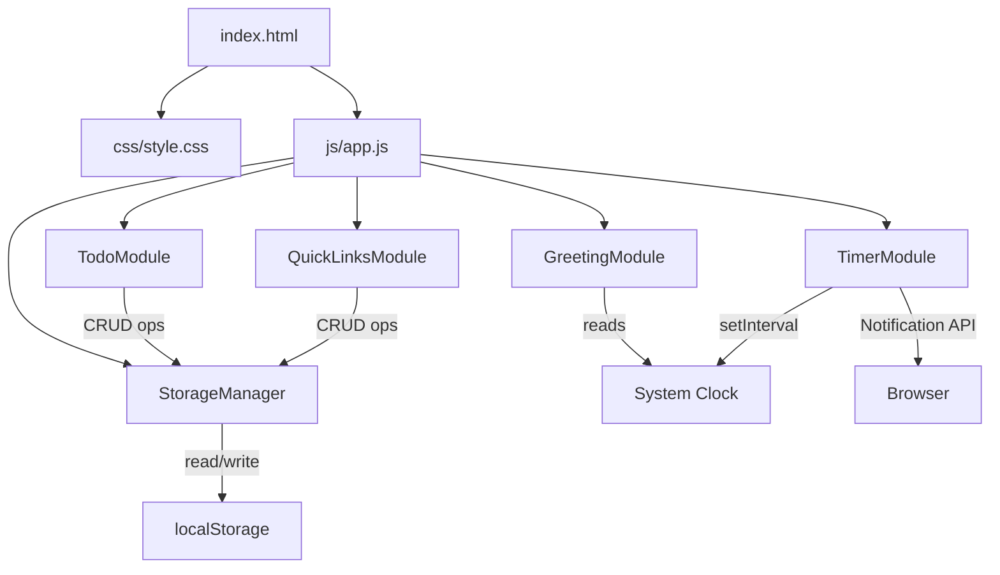
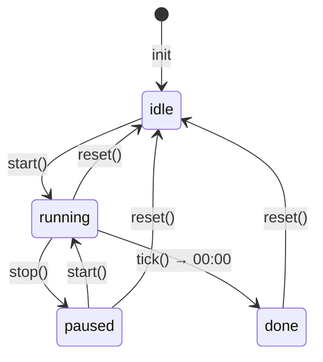

# Design Document — To Do List Life Dashboard

## Overview

To Do List Life Dashboard adalah sebuah single-page web application yang berjalan sepenuhnya di sisi klien (client-side only). Dibangun tanpa framework dengan HTML, CSS, dan Vanilla JavaScript murni, dashboard ini dapat dibuka langsung sebagai file lokal (`file://`) di browser manapun tanpa memerlukan server.

Tujuan utama desain adalah **kesederhanaan dan portabilitas**: satu file HTML, satu file CSS, satu file JavaScript — tidak ada build step, tidak ada dependency eksternal. Semua data disimpan di `localStorage` browser, sehingga data tetap tersedia antar sesi tanpa akun atau backend.

### Empat komponen utama yang bekerja secara terpadu:

1. **Greeting_Component** — Menampilkan waktu real-time, tanggal dalam Bahasa Indonesia, dan sapaan kontekstual berbasis jam.
2. **Timer_Component** — Pomodoro timer 25 menit dengan kontrol start/stop/reset dan notifikasi sesi selesai.
3. **Todo_Component** — CRUD daftar tugas dengan validasi input, toggle status, dan persistensi otomatis.
4. **QuickLinks_Component** — Manajemen tautan favorit dengan validasi URL dan batas maksimal 20 item.

Semua operasi penyimpanan dipusatkan ke **Storage_Manager**, sebuah modul tipis di atas `localStorage` yang menangani serialisasi, error handling, dan batching perubahan.

---

## Architecture

Karena tidak ada framework, arsitektur mengikuti pola **Module Pattern** berbasis ES Module-style dengan IIFE (Immediately Invoked Function Expression) agar kompatibel dengan `file://` tanpa server ES Module. Setiap komponen adalah modul JavaScript yang mandiri (self-contained), diinisialisasi oleh satu orkestrator utama di `app.js`.



### Prinsip Arsitektur

- **Unidirectional data flow**: DOM event → Module function → StorageManager → re-render
- **Tidak ada shared mutable state** antar modul; tiap modul mengelola state internalnya sendiri
- **StorageManager** adalah satu-satunya titik akses ke `localStorage`, menghindari duplikasi key dan konflik
- **Graceful degradation**: jika `localStorage` tidak tersedia (private mode), app tetap berjalan dengan state in-memory untuk sesi tersebut

### Struktur File

```
project-root/
├── index.html          ← satu-satunya file HTML
├── css/
│   └── style.css       ← satu-satunya file CSS
└── js/
    └── app.js          ← satu-satunya file JavaScript
```

Semua modul ditulis dalam satu file `app.js` menggunakan function scope untuk isolasi, diorkestrasi oleh fungsi `init()` yang dipanggil saat `DOMContentLoaded`.

---

## Components and Interfaces

### StorageManager

Modul fondasi yang diinisialisasi pertama. Semua modul lain bergantung padanya.

```javascript
const StorageManager = (() => {
  const KEYS = {
    TASKS: 'tld_tasks',
    LINKS: 'tld_links',
  };

  function get(key)       // → Array | null
  function set(key, data) // → boolean (success/fail)
  function isAvailable()  // → boolean
})();
```

- `get(key)` — Membaca dari `localStorage`, parse JSON, kembalikan `null` jika key tidak ada atau data tidak valid (JSON parse error).
- `set(key, data)` — Serialize ke JSON dan tulis ke `localStorage`. Mengembalikan `false` dan menampilkan pesan error jika operasi gagal (quota exceeded, private mode).
- `isAvailable()` — Cek ketersediaan `localStorage` dengan test write/read/delete.

---

### GreetingModule

Bertanggung jawab atas tampilan waktu, tanggal, dan sapaan.

```javascript
const GreetingModule = (() => {
  function init()         // pasang interval, render pertama kali
  function render()       // update DOM: jam, tanggal, sapaan
  function getGreeting(hour) // → string sapaan Bahasa Indonesia
  function formatDate(date)  // → string "Kamis, 15 Oktober 2026"
})();
```

**Logika sapaan:**

| Rentang Jam | Sapaan          |
|-------------|-----------------|
| 05:00–11:59 | Selamat Pagi    |
| 12:00–14:59 | Selamat Siang   |
| 15:00–17:59 | Selamat Sore    |
| 18:00–04:59 | Selamat Malam   |

Update berjalan via `setInterval` setiap 1000ms. Pada inisialisasi, `render()` dipanggil langsung sehingga tampilan muncul dalam < 500ms.

---

### TimerModule

Mengelola Pomodoro timer dengan state machine sederhana.

```javascript
const TimerModule = (() => {
  // State: { remaining: number(ms), status: 'idle'|'running'|'paused'|'done' }

  function init()          // render awal, pasang event listeners
  function start()         // mulai/lanjutkan countdown
  function stop()          // pause countdown, simpan remaining
  function reset()         // kembalikan ke 25:00, status → idle
  function tick()          // dikurangi 1 detik, cek 00:00
  function notifyDone()    // coba Notification API, fallback ke in-page message
  function renderDisplay() // update DOM MM:SS
  function updateButtons() // aktifkan/nonaktifkan Start & Stop sesuai status
})();
```

**State machine:**



Timer menggunakan `setInterval` berbasis waktu absolut (bukan counter semata) untuk meminimalkan drift: pada setiap tick, `remaining` dihitung dari `Date.now() - startTimestamp`.

---

### TodoModule

Mengelola daftar Task: tambah, edit, toggle selesai, hapus.

```javascript
const TodoModule = (() => {
  // State: tasks = Array<Task>

  function init()                    // muat dari Storage, render
  function addTask(text)             // validasi → push → save → render
  function editTask(id, newText)     // validasi → update → save → render
  function toggleTask(id)            // flip completed → save → render
  function deleteTask(id)            // filter out → save → render
  function validateText(text)        // → { valid: boolean, error: string|null }
  function render()                  // rebuild task list DOM
  function renderTask(task)          // → HTMLElement untuk satu task
  function showError(message)        // tampilkan pesan error di UI
})();
```

**Aturan validasi teks:**
- Teks setelah trim tidak boleh kosong (length === 0)
- Teks setelah trim tidak boleh melebihi 200 karakter

---

### QuickLinksModule

Mengelola koleksi QuickLink: tambah dan hapus.

```javascript
const QuickLinksModule = (() => {
  // State: links = Array<QuickLink>

  function init()                    // muat dari Storage, render
  function addLink(label, url)       // validasi → push → save → render
  function deleteLink(id)            // filter out → save → render
  function validateLabel(label)      // → { valid: boolean, error: string|null }
  function validateUrl(url)          // → { valid: boolean, error: string|null }
  function render()                  // rebuild links DOM
  function renderLink(link)          // → HTMLElement untuk satu link
  function updateAddButtonState()    // disable/enable tombol tambah berdasarkan count
})();
```

**Aturan validasi:**
- Label: setelah trim, panjang 1–50 karakter
- URL: harus dimulai dengan `http://` atau `https://`, panjang ≤ 2048 karakter
- Batas maksimal 20 QuickLink; tombol tambah dinonaktifkan jika sudah mencapai batas

---

## Data Models

### Task

```javascript
/**
 * @typedef {Object} Task
 * @property {string}  id        - UUID unik (crypto.randomUUID() atau fallback)
 * @property {string}  text      - Teks tugas (1–200 karakter, sudah di-trim)
 * @property {boolean} completed - Status selesai (default: false)
 * @property {number}  createdAt - Unix timestamp (ms) saat task dibuat
 */
```

Contoh nilai valid:
```json
{
  "id": "a1b2c3d4-...",
  "text": "Belajar algoritma sorting",
  "completed": false,
  "createdAt": 1728950400000
}
```

### QuickLink

```javascript
/**
 * @typedef {Object} QuickLink
 * @property {string} id        - UUID unik
 * @property {string} label     - Teks tampilan (1–50 karakter, sudah di-trim)
 * @property {string} url       - URL tujuan (http/https, ≤2048 karakter)
 * @property {number} createdAt - Unix timestamp (ms) saat link dibuat
 */
```

Contoh nilai valid:
```json
{
  "id": "e5f6g7h8-...",
  "label": "GitHub",
  "url": "https://github.com",
  "createdAt": 1728950400000
}
```

### localStorage Schema

| Key         | Type           | Deskripsi                         |
|-------------|----------------|-----------------------------------|
| `tld_tasks` | `Array<Task>`  | Seluruh daftar Task               |
| `tld_links` | `Array<QuickLink>` | Seluruh daftar QuickLink      |

Data disimpan sebagai JSON string. Jika parse gagal, StorageManager mengembalikan `null` dan modul yang memanggil akan menampilkan state kosong.

### UUID Generation

Menggunakan `crypto.randomUUID()` jika tersedia (browser modern). Fallback ke implementasi sederhana berbasis `Math.random()` dan timestamp untuk browser lama:

```javascript
function generateId() {
  if (typeof crypto !== 'undefined' && crypto.randomUUID) {
    return crypto.randomUUID();
  }
  return 'id-' + Date.now() + '-' + Math.random().toString(36).slice(2);
}
```

---

## Correctness Properties

*A property is a characteristic or behavior that should hold true across all valid executions of a system — essentially, a formal statement about what the system should do. Properties serve as the bridge between human-readable specifications and machine-verifiable correctness guarantees.*

---

### Property 1: Format Waktu Selalu HH:MM

*Untuk semua* kombinasi nilai jam (0–23) dan menit (0–59), fungsi `formatTime(hour, minute)` SHALL selalu menghasilkan string dengan pola tepat dua digit jam, titik dua, dua digit menit — tidak pernah menghasilkan format satu digit tanpa padding nol.

**Validates: Requirements 1.1**

---

### Property 2: Format Tanggal Bahasa Indonesia

*Untuk semua* objek `Date` yang valid, fungsi `formatDate(date)` SHALL selalu menghasilkan string yang mengandung salah satu dari tujuh nama hari Bahasa Indonesia ("Minggu", "Senin", "Selasa", "Rabu", "Kamis", "Jumat", "Sabtu") dan salah satu dari dua belas nama bulan Bahasa Indonesia ("Januari" … "Desember"), diikuti angka tahun empat digit.

**Validates: Requirements 1.2**

---

### Property 3: Sapaan Selalu Sesuai Jam

*Untuk semua* nilai jam (integer 0–23), fungsi `getGreeting(hour)` SHALL mengembalikan tepat satu dari empat sapaan yang pemetaannya exhaustive dan tidak tumpang tindih:
- hour ∈ [5, 11] → "Selamat Pagi"
- hour ∈ [12, 14] → "Selamat Siang"
- hour ∈ [15, 17] → "Selamat Sore"
- hour ∈ {0,1,2,3,4} ∪ {18,19,20,21,22,23} → "Selamat Malam"

**Validates: Requirements 1.3, 1.4, 1.5, 1.6**

---

### Property 4: Reset Timer Selalu Kembalikan ke 25:00

*Untuk semua* state timer yang mungkin (semua kombinasi nilai `remaining` dan status `idle/running/paused/done`), setelah memanggil `reset()`, nilai `remaining` SHALL sama dengan 25 × 60 × 1000 ms dan status SHALL menjadi `idle`.

**Validates: Requirements 2.6**

---

### Property 5: Notifikasi Selesai Memilih Strategi yang Tepat

*Untuk semua* kombinasi kondisi (browser mendukung / tidak mendukung Notification API) × (izin diberikan / ditolak), ketika `notifyDone()` dipanggil:
- Jika API tersedia DAN izin granted → SHALL menggunakan `new Notification()`
- Semua kondisi lainnya → SHALL menampilkan pesan selesai secara visual di dalam halaman

**Validates: Requirements 2.8, 2.9**

---

### Property 6: Penambahan Task Valid Selalu Masuk ke List

*Untuk semua* string teks yang setelah di-trim memiliki panjang antara 1 dan 200 karakter, memanggil `addTask(text)` pada list manapun SHALL menghasilkan list baru dengan panjang bertambah tepat 1 dan berisi Task dengan `task.text === text.trim()` serta `task.completed === false`.

**Validates: Requirements 3.1**

---

### Property 7: Teks Whitespace-Only Selalu Ditolak

*Untuk semua* string yang setelah di-trim menghasilkan string kosong (termasuk empty string, spasi, tab, newline, dan kombinasinya), fungsi `validateText(text)` SHALL mengembalikan `{ valid: false }` dan list tugas SHALL tidak berubah.

**Validates: Requirements 3.2**

---

### Property 8: Teks Lebih dari 200 Karakter Selalu Ditolak

*Untuk semua* string yang setelah di-trim memiliki panjang lebih dari 200 karakter, fungsi `validateText(text)` SHALL mengembalikan `{ valid: false }` dan list tugas SHALL tidak berubah.

**Validates: Requirements 3.3**

---

### Property 9: Edit Task Menerapkan Trim dan Mempertahankan ID

*Untuk semua* Task yang ada dan semua string edit yang valid (1–200 karakter setelah trim), setelah `editTask(id, newText)` dipanggil, Task dengan id tersebut SHALL memiliki `text === newText.trim()`, sedangkan `id` dan `createdAt` SHALL tidak berubah.

**Validates: Requirements 3.5**

---

### Property 10: Edit dengan Whitespace-Only Membatalkan Perubahan

*Untuk semua* Task yang ada dan semua string whitespace-only sebagai input edit, setelah pembatalan edit, `task.text` SHALL sama persis dengan nilai sebelum mode edit diaktifkan.

**Validates: Requirements 3.6**

---

### Property 11: Toggle Status Task adalah Round-Trip

*Untuk semua* Task dengan status `completed` awal apapun, memanggil `toggleTask(id)` dua kali berturut-turut SHALL menghasilkan Task dengan nilai `completed` yang identik dengan nilai semula.

**Validates: Requirements 3.7, 3.8**

---

### Property 12: Penghapusan Task Benar-Benar Menghapus dari List

*Untuk semua* array Task dan semua Task yang ada di dalamnya, setelah `deleteTask(id)`, list hasil SHALL tidak mengandung Task dengan id tersebut, dan semua Task lainnya SHALL tetap ada tanpa perubahan.

**Validates: Requirements 3.9**

---

### Property 13: Penambahan QuickLink Valid Selalu Masuk ke List (count < 20)

*Untuk semua* label (1–50 karakter setelah trim), URL valid (dimulai `http://` atau `https://`, panjang ≤ 2048), dan list QuickLink dengan jumlah < 20, memanggil `addLink(label, url)` SHALL menghasilkan list baru dengan panjang bertambah tepat 1 dan berisi QuickLink dengan `link.label === label.trim()` dan `link.url === url`.

**Validates: Requirements 4.1**

---

### Property 14: Label Whitespace-Only Selalu Ditolak

*Untuk semua* string yang setelah di-trim menghasilkan string kosong, fungsi `validateLabel(label)` SHALL mengembalikan `{ valid: false }`.

**Validates: Requirements 4.2**

---

### Property 15: URL Tidak Valid Selalu Ditolak

*Untuk semua* string URL yang tidak dimulai dengan `http://` atau `https://`, atau yang panjangnya melebihi 2048 karakter, fungsi `validateUrl(url)` SHALL mengembalikan `{ valid: false }`.

**Validates: Requirements 4.3**

---

### Property 16: Penghapusan QuickLink Benar-Benar Menghapus dari List

*Untuk semua* array QuickLink dan semua QuickLink yang ada di dalamnya, setelah `deleteLink(id)`, list hasil SHALL tidak mengandung QuickLink dengan id tersebut, dan semua QuickLink lainnya SHALL tetap ada tanpa perubahan.

**Validates: Requirements 4.5**

---

### Property 17: Tombol Tambah Sesuai dengan Jumlah QuickLink

*Untuk semua* array QuickLink dengan panjang antara 0 dan 20 (inklusif), setelah `updateAddButtonState()` dipanggil:
- Jika `links.length < 20` → tombol tambah SHALL dalam kondisi enabled
- Jika `links.length >= 20` → tombol tambah SHALL dalam kondisi disabled

**Validates: Requirements 4.9**

---

### Property 18: Storage Round-Trip Mempertahankan Data

*Untuk semua* array Task atau QuickLink yang valid (termasuk array kosong, satu elemen, dan banyak elemen dengan berbagai kombinasi nilai field), memanggil `StorageManager.set(key, data)` diikuti `StorageManager.get(key)` SHALL mengembalikan array yang deep-equal dengan data asli.

**Validates: Requirements 5.4**

---

### Property 19: Storage Gagal Tidak Menyebabkan Crash

*Untuk semua* operasi yang memicu penulisan ke `localStorage`, jika `localStorage.setItem()` melempar exception (misalnya QuotaExceededError atau SecurityError), aplikasi SHALL menampilkan pesan error yang deskriptif dan tetap berjalan tanpa melempar uncaught exception ke console.

**Validates: Requirements 5.5**

---

## Error Handling

### StorageManager

| Kondisi Error | Handling |
|---|---|
| `localStorage` tidak tersedia (private mode, SecurityError) | `isAvailable()` → false; semua modul berjalan dengan state in-memory; banner "Penyimpanan tidak tersedia" ditampilkan |
| `localStorage.setItem` melempar QuotaExceededError | Tampilkan pesan "Penyimpanan penuh. Data tidak dapat disimpan."; data in-memory tetap utuh |
| JSON parse error saat `get()` | Kembalikan `null`; modul pemanggil inisialisasi dengan array kosong |

### TodoModule

| Kondisi Error | Handling |
|---|---|
| Teks kosong/whitespace-only | Tolak, tampilkan error "Teks tugas tidak boleh kosong" |
| Teks > 200 karakter | Tolak, tampilkan error "Teks tugas maksimal 200 karakter" |
| Edit dengan teks kosong/whitespace | Batalkan edit, kembalikan ke teks semula |

### QuickLinksModule

| Kondisi Error | Handling |
|---|---|
| Label kosong/whitespace | Tolak, highlight field label dengan indikasi error |
| URL tidak valid (bukan http/https, > 2048 char) | Tolak, highlight field URL dengan indikasi error |
| Count sudah 20, coba tambah | Tombol sudah disabled; pesan informasi tetap tampil |

### TimerModule

| Kondisi Error | Handling |
|---|---|
| Start saat status `done` (00:00) | Tidak melakukan apapun; display tetap di 00:00 |
| Notification API tidak didukung | Fallback ke in-page message visual |
| Izin notifikasi ditolak | Fallback ke in-page message visual |
| `Date.now()` mengembalikan nilai tidak valid | Tampilkan "--:--" sebagai placeholder; tidak crash |

### GreetingModule

| Kondisi Error | Handling |
|---|---|
| `new Date()` menghasilkan Invalid Date | Tampilkan "-- : --" untuk jam dan "Tanggal tidak tersedia" untuk tanggal |

---

## Testing Strategy

### Pendekatan Dual Testing

Dashboard ini menggunakan kombinasi **property-based tests** untuk memverifikasi kebenaran universal logika inti, dan **unit tests/integration tests** untuk kasus spesifik, edge case, dan perilaku yang tidak bervariasi dengan input.

### Library Property-Based Testing

Karena proyek ini adalah Vanilla JS tanpa build tool, testing menggunakan **[fast-check](https://github.com/dubzzz/fast-check)** yang dapat dimuat via CDN di file test HTML, atau digunakan dengan Node.js untuk testing non-UI modules.

```html
<!-- Untuk file test HTML standalone -->
<script src="https://cdn.jsdelivr.net/npm/fast-check/lib/bundle/fast-check.min.js"></script>
```

### Konfigurasi Property Tests

- **Minimum 100 iterasi** per property test (fast-check default: 100, dapat ditingkatkan dengan `{ numRuns: 200 }`)
- Setiap property test diberi tag komentar dengan format:
  ```javascript
  // Feature: todo-life-dashboard, Property N: <deskripsi singkat property>
  ```

### Cakupan Unit Tests (Non-Property)

Unit tests dengan contoh spesifik difokuskan pada:

1. **Nilai batas (boundary values)**: panjang string tepat 1, 200, 201 karakter
2. **Kondisi timer**: inisialisasi 25:00, behavior saat 00:00
3. **Integrasi Storage**: verifikasi setiap operasi CRUD memanggil `StorageManager.set()`
4. **UI behavior**: QuickLink membuka tab baru (`target="_blank"`)
5. **Empty state**: list kosong dari Storage, data Storage corrupt

### Cakupan Integration Tests

- Load halaman dari `file://`, verifikasi semua komponen terinisialisasi tanpa JS error
- Data persists setelah simulasi reload (simpan → bersihkan memory → muat ulang → verifikasi)

### Smoke Tests

- `localStorage` tersedia di semua browser target (Chrome, Firefox, Edge, Safari latest)
- Tidak ada ES Module import yang memerlukan server (kompatibel `file://`)
- Tidak ada horizontal scroll pada viewport 320px dan 1920px
- Tidak ada error di browser console saat membuka halaman

### Matriks Property Tests

| Property | Modul | Generator Arbiter | Tag |
|---|---|---|---|
| 1 - Format Waktu HH:MM | GreetingModule | `fc.integer({min:0,max:23})`, `fc.integer({min:0,max:59})` | Property 1 |
| 2 - Format Tanggal B.Indonesia | GreetingModule | `fc.date()` | Property 2 |
| 3 - Sapaan Sesuai Jam | GreetingModule | `fc.integer({min:0,max:23})` | Property 3 |
| 4 - Reset Timer ke 25:00 | TimerModule | `fc.integer({min:0,max:1500000})`, `fc.oneof(fc.constant('idle'), ...)` | Property 4 |
| 5 - Notifikasi Strategi Tepat | TimerModule | `fc.boolean()`, `fc.boolean()` | Property 5 |
| 6 - Tambah Task Valid | TodoModule | `fc.string({minLength:1, maxLength:200})` | Property 6 |
| 7 - Whitespace Ditolak | TodoModule | `fc.stringOf(fc.constantFrom(' ','\t','\n','\r'))` | Property 7 |
| 8 - Teks >200 Ditolak | TodoModule | `fc.string({minLength:201, maxLength:500})` | Property 8 |
| 9 - Edit Task Trim & Preserve ID | TodoModule | `fc.record({...})`, `fc.string({minLength:1,maxLength:200})` | Property 9 |
| 10 - Edit Whitespace Batalkan | TodoModule | `fc.record({...})`, `fc.stringOf(fc.constantFrom(' ','\t'))` | Property 10 |
| 11 - Toggle Round-Trip | TodoModule | `fc.record({...completed: fc.boolean()})` | Property 11 |
| 12 - Hapus Task | TodoModule | `fc.array(taskArb)`, pilih satu id secara acak | Property 12 |
| 13 - Tambah QuickLink Valid | QuickLinksModule | `fc.string({minLength:1,maxLength:50})`, URL arbiter | Property 13 |
| 14 - Label Whitespace Ditolak | QuickLinksModule | `fc.stringOf(fc.constantFrom(' ','\t'))` | Property 14 |
| 15 - URL Invalid Ditolak | QuickLinksModule | URL tanpa prefix atau panjang >2048 | Property 15 |
| 16 - Hapus QuickLink | QuickLinksModule | `fc.array(linkArb)`, pilih satu id secara acak | Property 16 |
| 17 - Tombol Sesuai Count | QuickLinksModule | `fc.integer({min:0,max:20})` | Property 17 |
| 18 - Storage Round-Trip | StorageManager | `fc.array(taskArb)` + `fc.array(linkArb)` | Property 18 |
| 19 - Storage Gagal Tidak Crash | StorageManager | Mock `localStorage.setItem` throw | Property 19 |
